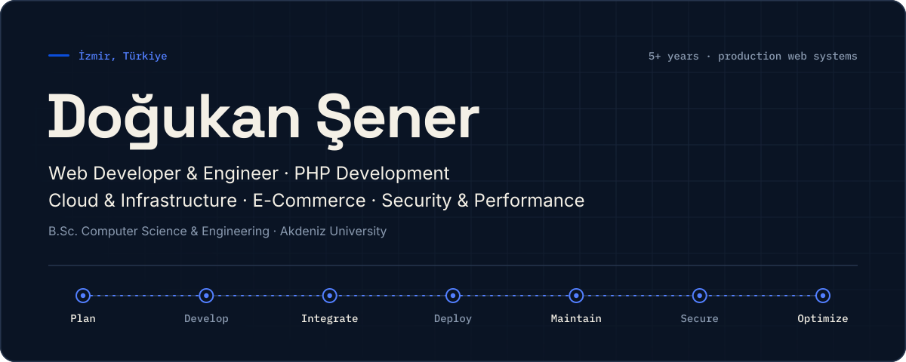
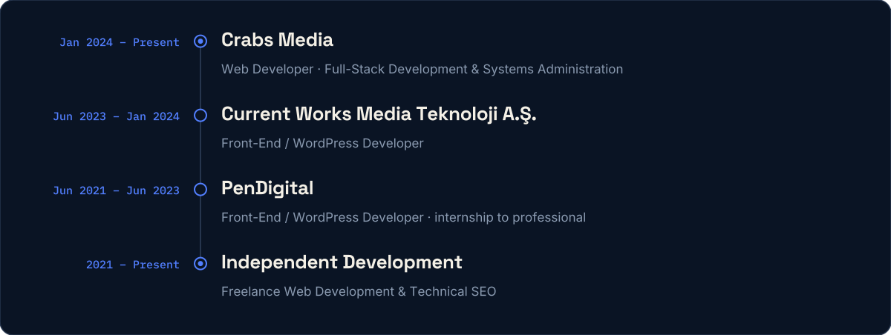

<picture>
  <source media="(max-width: 600px)" srcset="./assets/profile-banner-mobile.svg">
  
</picture>

## Professional introduction

I'm a multidisciplinary web engineer with **5+ years** of professional experience across agency environments, corporate web development, international e-commerce and production infrastructure. My work bridges application development, infrastructure and digital business requirements.

That covers custom PHP development, responsive front-end engineering, CMS architecture, API integrations, e-commerce systems, hosting administration, AWS environments, technical security and search performance.

I don't just build websites. I develop, deploy, maintain, troubleshoot, secure and improve production web systems.

**Based in** İzmir, Türkiye · **Education** B.Sc. Computer Science &amp; Engineering, Akdeniz University

## Engineering & technical expertise

<picture>
  <source media="(max-width: 600px)" srcset="./assets/expertise-mobile.svg">
  
</picture>

## Technology stack

<picture>
  <source media="(max-width: 600px)" srcset="./assets/tech-stack-mobile.svg">
  
</picture>

Solid cards reflect established professional work. The dashed **Exploring** card lists interests I'm actively learning outside core client work.

## Professional experience

<picture>
  <source media="(max-width: 600px)" srcset="./assets/experience-mobile.svg">
  
</picture>

### Crabs Media
`Jan 2024 – Present` · Web Developer / Full-Stack Development & Systems Administration

- Develop and maintain custom WordPress and PHP solutions for healthcare and corporate clients, within an agency serving 300+ clinics.
- Contributed directly to clinic websites and 20+ corporate web projects.
- Build multilingual websites, medical service templates, custom forms and CRM/lead integrations.
- Handle hosting, AWS operations, server administration, DNS, SSL, mail systems, migrations, deployment and security troubleshooting.
- Improve technical SEO, front-end performance and maintainability.

### Current Works Media Teknoloji A.Ş.
`Jun 2023 – Jan 2024` · Front-End / WordPress Developer

- Developed custom WordPress websites and e-commerce implementations.
- Converted Figma designs into responsive front-end interfaces.
- Worked on multilingual corporate websites and Shopify/WooCommerce projects.
- Managed assigned projects independently, including client communication and implementation decisions.

### PenDigital
`Jun 2021 – Jun 2023` · Front-End / WordPress Developer

- Progressed from internship to professional front-end development.
- Developed responsive websites using HTML, CSS/LESS, JavaScript, jQuery and PHP.
- Implemented custom WordPress themes and reusable front-end structures.

### Independent development
`2021 – Present` · Freelance Web Development & Technical SEO

- Delivered independent client projects, website maintenance, performance optimization and technical SEO services.

## Selected commercial work

<picture>
  <source media="(max-width: 600px)" srcset="./assets/commercial-work-mobile.svg">
  
</picture>

**Other selected work:** DTF Ghost · Kolay Tişört · Orfis · Orfis Home · Orçelik · Carpex Scenting · DoubleCheckReal · Atlantis Handmade · Gürsüt · Turkish Cymbals · Ketuna · Ege Mikrobiyal · Toda Gloria

## Infrastructure & security experience

| Area | What I handle |
|:--|:--|
| **Hosting & servers** | AWS environments, Linux hosting, WHM/cPanel, Plesk, Apache, LiteSpeed |
| **Domains & delivery** | DNS administration, SSL/TLS, Cloudflare |
| **Email** | Mail systems, Amazon SES, SPF, DKIM, DMARC |
| **Migrations & releases** | Server migrations, deployments, production troubleshooting |
| **Security** | Server hardening, access controls, suspicious traffic investigation, compromised website recovery |
| **Continuity** | Backup strategies and incident troubleshooting |

## Education & certification

| Institution | Credential |
|:--|:--|
| **Akdeniz University** | B.Sc. Computer Science & Engineering |
| **IBM SkillsBuild + Kodluyoruz** | CyberStart Completion Certificate · June 2024 |

## Academic projects & GitHub repositories

**HopeNest** · [dkansener/hope-nest](https://github.com/dkansener/hope-nest) 
Flutter/Firebase university capstone. UI/UX wireframes, Figma design, coordination and documentation.

**Apartment Management System** · not public 
PHP/MySQL academic full-stack project with database design and CRUD workflows.

Much of my professional work lives in private client and agency repositories, so public repositories show only part of it.

## Engineering philosophy

- **Own the whole lifecycle:** planning, development, integration, deployment, maintenance, security and optimization are one job.
- **Production first:** what matters is how a system behaves live, under real traffic, real content and real failures.
- **Security as routine:** hardening, access control, email authentication and backups belong in everyday operations.
- **Performance is a requirement:** Core Web Vitals and technical SEO are built in, not added at the end.
- **Editor-friendly systems:** clients should manage routine content and commerce changes without a developer.

## Contact & professional links

İzmir, Türkiye
