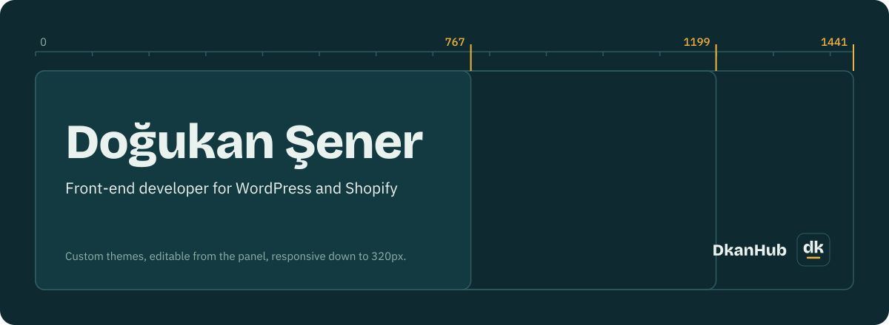

<div align="center">
  <picture>
    <source media="(max-width: 600px)" srcset="./assets/dkanhub-banner-mobile.svg">
    
  </picture>
</div>

<div align="center">

## Hi, I'm Doğukan Şener 👋

**Web Developer · E-Commerce Engineer · Technical SEO & Digital Product Builder**

*I build digital experiences where design, engineering, search visibility and business goals meet.*

[](https://dkanhub.com)
[](https://github.com/dkansener)

</div>

---

## About me

I'm a web developer and digital product builder focused on turning complex requirements into practical, maintainable digital experiences. My work spans **custom website development**, **e-commerce implementations**, **performance and technical SEO**, and the architecture of new products and workflows.

I care about what happens *after* a website goes live: can the team manage it, can search engines understand it, is it accessible and fast, and can the system grow without becoming difficult to maintain?

Rather than limiting my work to a single CMS or framework, I approach each project from its technical and business requirements.

## What I work on

| Area | Focus |
|:--|:--|
| **Web engineering** | Custom interfaces, responsive front-end, component systems, integrations |
| **WordPress** | Custom themes, editable admin panels, multilingual builds |
| **Shopify & e-commerce** | Liquid themes, store interfaces, product discovery, commerce UX |
| **Technical SEO** | Crawlability, site structure, structured data, indexing, audits |
| **GEO / AI search** | How brands and sources appear in AI-powered answers and citations |
| **Digital products** | SaaS concepts, product specs, dashboards, internal tools |
| **Performance & quality** | Core Web Vitals, accessibility, mobile behavior, deployment readiness |
| **AI-assisted workflows** | Research, automation and developer productivity, used responsibly |

## Technical toolkit

**Hands-on, used in production work**


**Areas I'm actively developing and exploring**

`SaaS architecture` · `SEO / GEO monitoring` · `Crawling and diagnostics` · `E-commerce intelligence` · `Analytics dashboards` · `Automation` · `AI-assisted workflows`

## Selected initiatives

<table>
<tr><td width="50%" valign="top">

### 🔎 DKAN Visibility

**Technical SEO, GEO and visibility intelligence**

A product initiative focused on website diagnostics, SEO issue detection, backlink insights, AI-search visibility and competitor analysis.

`Product development · concept evolving`

</td><td width="50%" valign="top">

### 🛍️ DK Commerce

**Commerce content and discovery**

An initiative around commerce-oriented content, brand discovery, promotional offers and comparison experiences.

`Product development · concept evolving`

</td></tr>
<tr><td width="50%" valign="top">

### 🧩 Custom Web Projects

**WordPress and Shopify implementation**

Custom themes, admin-editable sections, localized experiences and responsive sites built to be practical for the people managing them.

`Client work · case studies coming soon`

</td><td width="50%" valign="top">

### 🌐 DKAN Hub

**My independent portfolio and product space**

A home for selected work, technical writing, experiments and digital products.

`Portfolio under development`

</td></tr>
</table>

## My approach

```text
Understand the problem
        ↓
Define a practical architecture
        ↓
Build with maintainability in mind
        ↓
Test performance, usability and search readiness
        ↓
Measure, learn and improve
```

- **Product-aware engineering:** the goal isn't just a completed interface; it's a useful system.
- **Performance by default:** speed, mobile behavior and accessibility are part of the build.
- **Editable where it matters:** content teams should not need developers for every routine update.
- **Visibility beyond launch:** technical SEO and discoverability are built into planning.
- **Sustainable workflows:** shared coding standards and thoughtful AI assistance support consistency.

## Currently exploring

- Measuring visibility in AI-powered search and mapping sources and citations.
- Building repeatable technical SEO diagnostics and competitor-analysis workflows.
- Designing modular dashboards for SaaS and e-commerce tools.
- Developing a stronger public collection of engineering case studies and technical notes.

## Let's connect

I'm interested in **web engineering, e-commerce, search visibility and thoughtful digital products**. Explore my work at **[DKANHub.com](https://dkanhub.com)** or browse the repositories below.

---

<div align="center">
  <sub>Designed around clarity, performance and practical digital engineering.</sub><br />
  <sub>© Doğukan Şener · DKAN Hub</sub>
</div>
