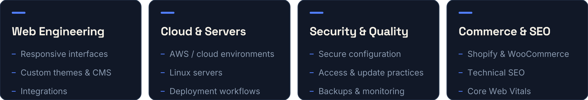

<div align="center">
  <picture>
    <source media="(max-width: 600px)" srcset="./assets/profile-banner-mobile.png">
    
  </picture>
</div>

<div align="center">

## Hi, I'm Doğukan 👋

**Web Engineer · Cloud & Infrastructure · E-Commerce · Security & Performance**

I work across the entire web delivery lifecycle, from building interfaces and commerce experiences to deploying, maintaining and improving the systems behind them.

</div>

---

## About me

I'm Doğukan Şener, a developer working across web technologies, e-commerce implementations and the infrastructure that supports them. My approach combines practical front-end engineering with deployment, system operations, technical quality and search visibility.

I focus on making websites and platforms **manageable, maintainable, performant and secure**, not just visually complete. That includes content management systems, custom themes, responsive experiences, hosting environments and technical optimization.

I prefer solving the full problem: understanding the requirements, building the interface, considering the server environment, and making the result sustainable for the people who use and maintain it.

## Areas of practice

<p>
<picture>
  <source media="(max-width: 600px)" srcset="./assets/focus-areas-mobile.png">
  
</picture>
</p>

| Discipline | Scope |
|:--|:--|
| **Web development** | Responsive interfaces, custom themes, CMS architecture, integrations |
| **Cloud & infrastructure** | AWS / cloud environments, Linux servers, hosting, DNS, SSL/TLS, deployments |
| **Server operations** | Web server configuration, monitoring, backups, maintenance, troubleshooting |
| **Web security** | Secure configuration, access controls, updates, exposure reduction, hardening |
| **E-commerce** | Shopify, WooCommerce, storefront UX, theme customization |
| **Technical SEO & performance** | Crawlability, indexability, structured data, Core Web Vitals, diagnostics |
| **Engineering workflow** | Git-based development, reusable components, AI-assisted workflows |

> Listed areas of work do not imply certifications, years of experience or proficiency levels. Verified credentials and public case studies can be added separately.

## Technical landscape

**Languages & front-end**


**CMS & e-commerce**


**Infrastructure & operations**


**Quality & visibility**


## How I approach projects

```text
01 DISCOVER   Needs and constraints
02 ARCHITECT  Maintainable structure
03 BUILD      Develop, integrate, test
04 SECURE     Access, config, risk
05 OPTIMIZE   Speed, UX, visibility
06 MAINTAIN   Document, monitor, evolve
```

## What matters to me

- **Engineering beyond the interface:** hosting, infrastructure and long-term upkeep are part of the job.
- **Performance as a requirement:** responsiveness, efficient delivery and technical SEO from the start.
- **Security-conscious delivery:** reliable systems need good operational practices.
- **Editor-friendly systems:** routine content and commerce changes shouldn't need a developer.
- **Practical automation:** tools and AI assistance used responsibly, with everything reviewed before it ships.

## GitHub & collaboration

My GitHub is a place for code, technical experiments and professional work. Many client projects and infrastructure work are private, so public repositories don't represent the full scope of my experience.

For conversations around web engineering, cloud infrastructure, commerce systems or technical optimization, connect through [GitHub](https://github.com/dkansener).

---

<p align="center">Doğukan Şener · Web engineering, infrastructure, e-commerce and performance</p>
