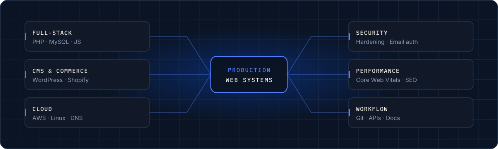
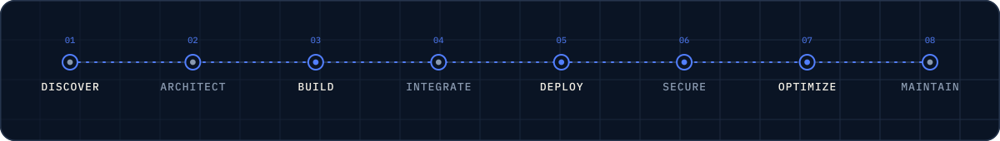

<b>EN</b> · <a href="./README.tr.md">TR</a>

<picture>
  <source media="(max-width: 600px)" srcset="./assets/hero-mobile.svg">
  
</picture>

<b>Doğukan Şener</b> · Full-Stack Development &amp; Systems Administration 
Currently at <b>Crabs Media</b> · Freelance web development &amp; technical consulting · İzmir, Türkiye

##  About me

I'm a Computer Engineering graduate with **7+ years** of professional experience, working across full-stack development and systems administration.

My work covers custom web development, PHP and MySQL applications, JavaScript interfaces, content management architectures, e-commerce platforms, AWS and Linux hosting, production operations, security troubleshooting and technical performance. I work across the whole delivery lifecycle, from implementation and integration to deployment, maintenance and optimization.

I currently work at **Crabs Media** and also take on **independent freelance projects** alongside that role.

<table>
<tr>
<td width="50%" valign="top"> <b>Current</b> Crabs Media, since January 2024</td>
<td width="50%" valign="top"> <b>Concurrent</b> Freelance web development &amp; technical consulting</td>
</tr>
<tr>
<td valign="top"> <b>Experience</b> 7+ years, professional</td>
<td valign="top"> <b>Location</b> İzmir, Türkiye</td>
</tr>
</table>

##  Engineering capabilities

<table>
<tr>
<td width="50%" valign="top">
 
<b>Full-stack web development</b> 
Custom backend logic in PHP and MySQL, dynamic forms, database operations, REST API integrations and reusable, responsive front-end components in JavaScript, HTML5 and CSS3.  
<code>php</code> <code>mysql</code> <code>javascript</code> <code>rest</code>
</td>
<td width="50%" valign="top">
 
<b>CMS &amp; e-commerce engineering</b> 
Custom WordPress, WooCommerce and Shopify themes; admin-editable systems with ACF, Gutenberg or Codestar Framework; multilingual architecture with WPML; custom product configuration and e-commerce integrations.  
<code>wordpress</code> <code>woocommerce</code> <code>liquid</code> <code>wpml</code>
</td>
</tr>
<tr>
<td width="50%" valign="top">
 
<b>Cloud infrastructure &amp; server administration</b> 
AWS and Linux hosting, WHM/cPanel and Plesk, Apache and LiteSpeed, Cloudflare, DNS, SSL/TLS, SMTP and domain management, plus server migrations, deployment, monitoring and troubleshooting.  
<code>aws</code> <code>linux</code> <code>cpanel</code> <code>cloudflare</code>
</td>
<td width="50%" valign="top">
 
<b>Web security &amp; system operations</b> 
Server hardening, access controls and secure configuration; troubleshooting compromised websites and investigating suspicious traffic; SPF, DKIM and DMARC; backups, recovery and operational reliability.  
<code>hardening</code> <code>spf</code> <code>dkim</code> <code>dmarc</code>
</td>
</tr>
<tr>
<td width="50%" valign="top">
 
<b>Performance &amp; technical SEO</b> 
Core Web Vitals (LCP, CLS, INP) with Lighthouse and PageSpeed Insights; caching and asset optimization; structured data, crawlability, indexability, analytics integrations and technical diagnostics.  
<code>cwv</code> <code>lighthouse</code> <code>schema</code>
</td>
<td width="50%" valign="top">
 
<b>Development tools &amp; workflow</b> 
Git, REST APIs, technical documentation and deployment workflows, with AI-assisted development used as a reviewed part of the process.  
<code>git</code> <code>docs</code> <code>deploy</code>
</td>
</tr>
</table>

##  Technology ecosystem

<picture>
  <source media="(max-width: 600px)" srcset="./assets/ecosystem-mobile.svg">
  
</picture>

<table>
<tr>
<td valign="top" width="30%">&nbsp; <b>Programming &amp; backend</b></td>
<td valign="top">&nbsp;PHP &nbsp;·&nbsp; &nbsp;MySQL &nbsp;·&nbsp; &nbsp;JavaScript &nbsp;·&nbsp; &nbsp;REST APIs 
Backend logic, data handling, forms and integrations for custom web features.</td>
</tr>
<tr>
<td valign="top" width="30%">&nbsp; <b>Front-end &amp; UI</b></td>
<td valign="top">&nbsp;HTML5 &nbsp;·&nbsp; &nbsp;CSS3 &nbsp;·&nbsp; &nbsp;jQuery &nbsp;·&nbsp; &nbsp;LESS &nbsp;·&nbsp; &nbsp;SCSS &nbsp;·&nbsp; &nbsp;Tailwind CSS &nbsp;·&nbsp; &nbsp;Bootstrap 
Responsive interfaces built from Figma designs, with reusable components.</td>
</tr>
<tr>
<td valign="top" width="30%">&nbsp; <b>CMS &amp; commerce</b></td>
<td valign="top">&nbsp;WordPress &nbsp;·&nbsp; &nbsp;Gutenberg &nbsp;·&nbsp; &nbsp;ACF &nbsp;·&nbsp; &nbsp;Codestar Framework &nbsp;·&nbsp; &nbsp;WPML &nbsp;·&nbsp; &nbsp;WooCommerce &nbsp;·&nbsp; &nbsp;Shopify Liquid 
Custom themes, admin-editable content, multilingual sites and storefronts.</td>
</tr>
<tr>
<td valign="top" width="30%">&nbsp; <b>Cloud &amp; infrastructure</b></td>
<td valign="top">&nbsp;AWS &nbsp;·&nbsp; &nbsp;Amazon SES &nbsp;·&nbsp; &nbsp;Linux &nbsp;·&nbsp; &nbsp;WHM/cPanel &nbsp;·&nbsp; &nbsp;Plesk &nbsp;·&nbsp; &nbsp;Apache &nbsp;·&nbsp; &nbsp;LiteSpeed 
Hosting setup and administration, migrations, deployment and troubleshooting.</td>
</tr>
<tr>
<td valign="top" width="30%">&nbsp; <b>Security &amp; networking</b></td>
<td valign="top">&nbsp;Cloudflare &nbsp;·&nbsp; &nbsp;DNS &nbsp;·&nbsp; &nbsp;SSL/TLS &nbsp;·&nbsp; &nbsp;SMTP &nbsp;·&nbsp; &nbsp;SPF &nbsp;·&nbsp; &nbsp;DKIM &nbsp;·&nbsp; &nbsp;DMARC 
Domain and certificate management, email authentication and edge protection.</td>
</tr>
<tr>
<td valign="top" width="30%">&nbsp; <b>Performance &amp; SEO</b></td>
<td valign="top">&nbsp;Lighthouse &nbsp;·&nbsp; &nbsp;PageSpeed Insights &nbsp;·&nbsp; &nbsp;Core Web Vitals &nbsp;·&nbsp; &nbsp;Structured data 
Measuring real bottlenecks, then fixing them at the source.</td>
</tr>
<tr>
<td valign="top" width="30%">&nbsp; <b>Development tools</b></td>
<td valign="top">&nbsp;Git &nbsp;·&nbsp; &nbsp;GitHub &nbsp;·&nbsp; &nbsp;Figma 
Version control, collaboration and design handoff.</td>
</tr>
</table>

##  Cloud infrastructure &amp; security

I look after the layers underneath the site, not only the code.

<table>
<tr>
<td width="50%" valign="top">
 
<b>Hosting</b> 
Set up and administer AWS and Linux hosting through WHM/cPanel and Plesk, on Apache and LiteSpeed.  
<code>aws</code> <code>linux</code> <code>cpanel</code> <code>plesk</code>
</td>
<td width="50%" valign="top">
 
<b>Domains &amp; delivery</b> 
Manage domains, DNS, SSL/TLS and Cloudflare; run deployments and server migrations.  
<code>dns</code> <code>ssl/tls</code> <code>cloudflare</code>
</td>
</tr>
<tr>
<td width="50%" valign="top">
 
<b>Email</b> 
Configure SMTP, mail systems and Amazon SES with SPF, DKIM and DMARC authentication.  
<code>smtp</code> <code>ses</code> <code>spf</code> <code>dkim</code> <code>dmarc</code>
</td>
<td width="50%" valign="top">
 
<b>Hardening</b> 
Apply server hardening, access controls and secure configuration.  
<code>hardening</code> <code>access</code>
</td>
</tr>
<tr>
<td width="50%" valign="top">
 
<b>Incidents</b> 
Investigate suspicious traffic, troubleshoot compromised websites and production issues.  
<code>triage</code> <code>recovery</code>
</td>
<td width="50%" valign="top">
 
<b>Reliability</b> 
Backups, recovery, monitoring and routine production maintenance.  
<code>backups</code> <code>monitoring</code>
</td>
</tr>
</table>

##  Performance &amp; technical optimization

Speed and search visibility are part of the build, not a later clean-up.

<table>
<tr>
<td width="50%" valign="top">
 
<b>Core Web Vitals</b> 
LCP, CLS and INP measured with Lighthouse and PageSpeed Insights, then fixed at the source.  
<code>lcp</code> <code>cls</code> <code>inp</code>
</td>
<td width="50%" valign="top">
 
<b>Delivery</b> 
Caching, asset optimization and image handling.  
<code>caching</code> <code>assets</code>
</td>
</tr>
<tr>
<td width="50%" valign="top">
 
<b>Crawlability</b> 
Site structure, indexability and metadata that search engines can follow.  
<code>indexing</code> <code>metadata</code>
</td>
<td width="50%" valign="top">
 
<b>Structured data &amp; analytics</b> 
Schema markup that matches the page, analytics integrations and technical diagnostics.  
<code>schema</code> <code>analytics</code>
</td>
</tr>
</table>

##  Engineering workflow

<picture>
  <source media="(max-width: 600px)" srcset="./assets/lifecycle-mobile.svg">
  
</picture>

I treat a website as a production system, not a one-off delivery. Each project moves from understanding the requirements and choosing a maintainable architecture, through building and integrating, to deploying, securing and optimizing it, and then keeping it healthy in production.

<table>
<tr><td></td><td><b>Git</b> for every project, with readable history</td></tr>
<tr><td></td><td><b>Documentation and development standards</b> so the next change is predictable</td></tr>
<tr><td></td><td><b>Deployment workflows</b> that keep releases repeatable</td></tr>
<tr><td></td><td><b>REST API integrations</b> designed to fail gracefully</td></tr>
<tr><td></td><td><b>AI-assisted development</b>, with every change reviewed before it ships</td></tr>
</table>

##  Professional background

<table>
<tr><th></th><th align="left">Period</th><th align="left">Role</th></tr>
<tr><td></td><td>2024 – present <code>current</code></td><td><b>Crabs Media</b> Web Developer · Full-Stack Development &amp; Systems Administration</td></tr>
<tr><td></td><td>2021 – present <code>concurrent</code></td><td><b>Freelance</b> Web development &amp; technical consulting, project-based</td></tr>
<tr><td></td><td>2023 – 2024 <code>previous</code></td><td><b>Current Works Media Teknoloji A.Ş.</b></td></tr>
<tr><td></td><td>2021 – 2023 <code>previous</code></td><td><b>PenDigital</b></td></tr>
</table>

<table>
<tr>
<td width="50%" valign="top"> <b>Education</b> Akdeniz University B.Sc. Computer Science &amp; Engineering</td>
<td width="50%" valign="top"> <b>Certification</b> IBM SkillsBuild + Kodluyoruz CyberStart Completion Certificate (2024)</td>
</tr>
</table>

##  Technical interests

Areas I'm actively exploring, separate from my established professional work:

&nbsp;<b>Python</b> for scripting and tooling 
&nbsp;Automation of routine development and operations work 
&nbsp;AI-assisted development workflows 
&nbsp;Software tooling and technical experiments

##  Connect

&nbsp;<a href="https://github.com/dkansener">github.com/dkansener</a> 
&nbsp; İzmir, Türkiye

