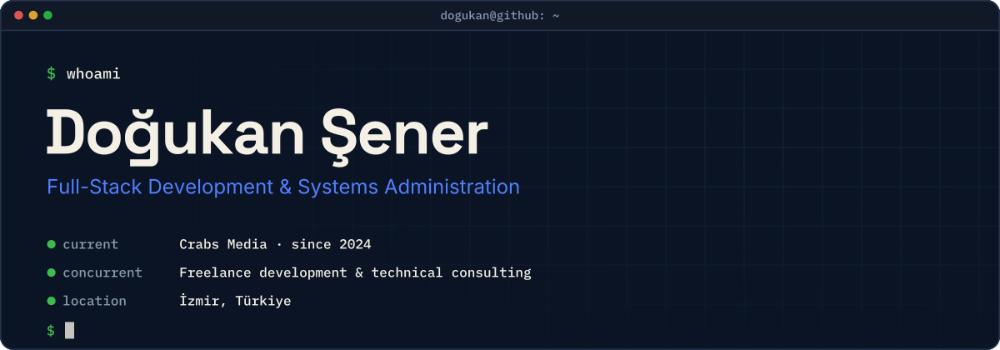
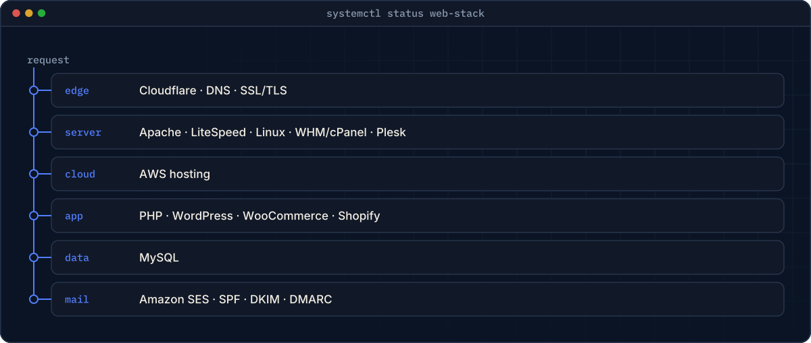
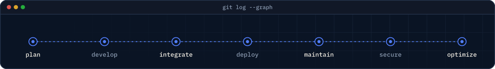

<picture>
  <source media="(max-width: 600px)" srcset="./assets/hero-mobile.svg">
  
</picture>

<p align="center">
<b>Doğukan Şener</b> · Full-Stack Development &amp; Systems Administration<br>
Currently at <b>Crabs Media</b> · Freelance development &amp; technical consulting · İzmir, Türkiye
</p>

<p align="center">


</p>

<p align="center"><code>&gt; building, deploying, securing and optimizing web systems</code></p>

<p></p>

## About me
`$ cat ~/about.md`

I work in **full-stack development and systems administration**, with **5+ years** of professional experience. I'm currently at **Crabs Media**, and alongside that role I take on **freelance web development and technical consulting** projects.

My work spans the full life of a website: planning, development, integration, deployment, maintenance, security and optimization. That means PHP development, front-end engineering, CMS architecture, e-commerce, cloud infrastructure, Linux hosting, security, technical SEO and performance.

I don't stop at building the site. I deploy it, keep it running, troubleshoot it when something breaks, secure it and keep improving it in production.

<p></p>

## What I work with
`$ ls ~/stack`

| Area | Stack |
|:--|:--|
| **Languages** | <kbd>PHP</kbd> <kbd>MySQL</kbd> <kbd>JavaScript</kbd> <kbd>HTML</kbd> <kbd>CSS</kbd>  |
| **Front-end** | <kbd>jQuery</kbd> <kbd>LESS</kbd> <kbd>SCSS</kbd> <kbd>Tailwind CSS</kbd> <kbd>Bootstrap</kbd>  |
| **CMS** | <kbd>WordPress</kbd> <kbd>Gutenberg</kbd> <kbd>ACF</kbd> <kbd>WPML</kbd> <kbd>Codestar Framework</kbd>  |
| **E-commerce** | <kbd>WooCommerce</kbd> <kbd>Shopify Liquid</kbd>  |
| **Cloud & hosting** | <kbd>AWS</kbd> <kbd>Amazon SES</kbd> <kbd>Linux</kbd> <kbd>WHM/cPanel</kbd> <kbd>Plesk</kbd>  |
| **Servers & edge** | <kbd>Apache</kbd> <kbd>LiteSpeed</kbd> <kbd>Cloudflare</kbd> <kbd>DNS</kbd> <kbd>SSL/TLS</kbd>  |
| **Email security** | <kbd>SPF</kbd> <kbd>DKIM</kbd> <kbd>DMARC</kbd>  |
| **Performance** | <kbd>Lighthouse</kbd> <kbd>PageSpeed Insights</kbd> <kbd>Core Web Vitals</kbd>  |
| **Workflow** | <kbd>Git</kbd> <kbd>REST APIs</kbd> <kbd>AI-assisted development</kbd>  |

<p></p>

## Engineering capabilities
`$ man capabilities`

<details open>
<summary><b>Web & backend engineering</b> &nbsp;<code>php</code> <code>mysql</code> <code>js</code> <code>rest</code></summary>
<br>

Custom PHP solutions where an off-the-shelf plugin or theme isn't the right fit.

- Dynamic, data-driven features backed by MySQL
- Custom forms with validation and server-side handling
- REST API and third-party integrations, including CRM and lead flows
- Reusable architecture so the next feature starts from tested parts

</details>

<details>
<summary><b>Front-end development</b> &nbsp;<code>html</code> <code>css</code> <code>less</code> <code>scss</code> <code>tailwind</code></summary>
<br>

Turning Figma designs into responsive interfaces that hold up on every device.

- Responsive layouts checked across breakpoints, down to small phones
- Maintainable stylesheets in LESS, SCSS or Tailwind CSS, following the project's conventions
- Interactive components (sliders, tabs, forms, menus) without unnecessary dependencies

</details>

<details>
<summary><b>CMS & e-commerce</b> &nbsp;<code>wordpress</code> <code>woocommerce</code> <code>shopify</code></summary>
<br>

Sites that editors and store owners can run without a developer for routine changes.

- Custom WordPress themes with admin panels built on Gutenberg, ACF or Codestar Framework
- Multilingual architecture with WPML
- WooCommerce and Shopify storefronts, custom themes and configurable product flows
- Integrations between the CMS, the store and external services

</details>

<p></p>

## Infrastructure & security
`$ systemctl status web-stack`

I look after the layers underneath the site, not only the code.

<picture>
  <source media="(max-width: 600px)" srcset="./assets/infra-mobile.svg">
  
</picture>

| Area | What I do |
|:--|:--|
| **Hosting** | Set up and administer AWS and Linux hosting through WHM/cPanel and Plesk |
| **Delivery** | Manage DNS, SSL/TLS and Cloudflare; run deployments and server migrations |
| **Email** | Configure mail systems and Amazon SES with SPF, DKIM and DMARC authentication |
| **Hardening** | Apply server hardening and access controls |
| **Incidents** | Investigate suspicious traffic, remediate compromised websites, troubleshoot production issues |
| **Continuity** | Maintain backups and routine production maintenance |

<p></p>

## Performance & technical SEO
`$ lighthouse --audit`

Speed and search visibility are part of the build, not a later clean-up.

| Focus | What I look at |
|:--|:--|
| **Core Web Vitals** | <kbd>LCP</kbd> <kbd>CLS</kbd> <kbd>INP</kbd> measured with Lighthouse and PageSpeed Insights |
| **Front-end delivery** | Asset optimization, image handling, caching |
| **Crawlability** | Site structure, indexability, metadata |
| **Structured data** | Schema markup that matches the page content |

<p></p>

## Development workflow
`$ git log --graph`

<picture>
  <source media="(max-width: 600px)" srcset="./assets/workflow-mobile.svg">
  
</picture>

- **Git** for every project, with readable history
- **Documentation and development standards** so the next change is predictable
- **API integrations** designed to fail gracefully
- **Automation** for repetitive operational tasks
- **AI-assisted development**, with every change reviewed before it ships

<p></p>

## Professional background
`$ cat ~/background`

```diff
+ 2024–now   Crabs Media
+            Web Developer · Full-Stack
+            & Systems Administration
+ 2021–now   Freelance
+            Web development
+            & technical SEO
  2023–2024  Current Works Media
             Teknoloji A.Ş.
  2021–2023  PenDigital
```

**Education** · Akdeniz University, B.Sc. Computer Science & Engineering<br>
**Certification** · IBM SkillsBuild + Kodluyoruz, CyberStart Completion Certificate (2024)

<p></p>

## Currently exploring
`$ cat ~/exploring.txt`

- <kbd>Python</kbd> for scripting and tooling
- Automation of routine development and operations work
- AI-assisted development workflows
- Software tooling and technical experiments

<p></p>

## Connect
`$ open github.com/dkansener`

**GitHub** · [github.com/dkansener](https://github.com/dkansener)<br>
**Location** · İzmir, Türkiye

```console
dogukan@github:~$ exit
```
