
<a href="./README.md">EN</a> · <b>TR</b>

<picture>
  <source media="(max-width: 600px)" srcset="./assets/hero-tr-mobile.svg">
  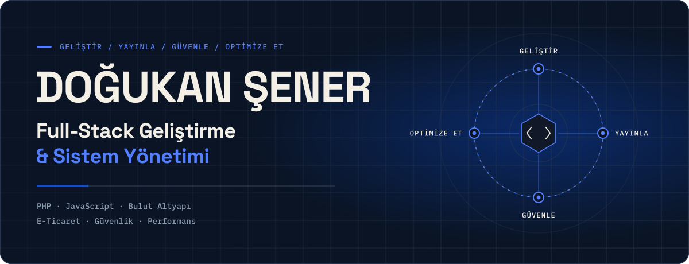
</picture>

<b>Doğukan Şener</b> · Full-Stack Geliştirme &amp; Sistem Yönetimi 
Şu anda <b>Crabs Media</b>'da · Freelance web geliştirme &amp; teknik danışmanlık · İzmir, Türkiye

## 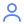 Hakkımda

Bilgisayar Mühendisliği mezunuyum; full-stack geliştirme ve sistem yönetimi alanlarında **7+ yıllık** profesyonel deneyimim var.

Çalışmalarım özel web geliştirme, PHP ve MySQL uygulamaları, JavaScript arayüzleri, içerik yönetim mimarileri, e-ticaret platformları, AWS ve Linux hosting, canlı sistem operasyonları, güvenlik sorunlarının çözümü ve teknik performansı kapsıyor. Uygulama ve entegrasyondan yayına alma, bakım ve optimizasyona kadar teslim sürecinin tamamında çalışıyorum.

Şu anda **Crabs Media**'da çalışıyorum; bu görevimle birlikte **bağımsız freelance projeler** de üstleniyorum.

<table>
<tr>
<td width="50%" valign="top"> <b>Mevcut</b> Crabs Media, Ocak 2024'ten beri</td>
<td width="50%" valign="top"> <b>Paralel</b> Freelance web geliştirme &amp; teknik danışmanlık</td>
</tr>
<tr>
<td valign="top"> <b>Deneyim</b> 7+ yıl, profesyonel</td>
<td valign="top"> <b>Konum</b> İzmir, Türkiye</td>
</tr>
</table>

##  Mühendislik yetkinlikleri

<table>
<tr>
<td width="50%" valign="top">
 
<b>Full-stack web geliştirme</b> 
PHP ve MySQL ile özel backend mantığı, dinamik formlar, veritabanı işlemleri, REST API entegrasyonları; JavaScript, HTML5 ve CSS3 ile yeniden kullanılabilir, responsive front-end bileşenleri.  
<code>php</code> <code>mysql</code> <code>javascript</code> <code>rest</code>
</td>
<td width="50%" valign="top">
 
<b>CMS &amp; e-ticaret mühendisliği</b> 
Özel WordPress, WooCommerce ve Shopify temaları; ACF, Gutenberg veya Codestar Framework ile panelden yönetilebilen sistemler; WPML ile çok dilli mimari; özel ürün yapılandırması ve e-ticaret entegrasyonları.  
<code>wordpress</code> <code>woocommerce</code> <code>liquid</code> <code>wpml</code>
</td>
</tr>
<tr>
<td width="50%" valign="top">
 
<b>Bulut altyapı &amp; sunucu yönetimi</b> 
AWS ve Linux hosting, WHM/cPanel ve Plesk, Apache ve LiteSpeed, Cloudflare, DNS, SSL/TLS, SMTP ve domain yönetimi; ayrıca sunucu taşıma, yayına alma, izleme ve sorun giderme.  
<code>aws</code> <code>linux</code> <code>cpanel</code> <code>cloudflare</code>
</td>
<td width="50%" valign="top">
 
<b>Web güvenliği &amp; sistem operasyonları</b> 
Sunucu sertleştirme, erişim kontrolleri ve güvenli yapılandırma; ele geçirilmiş sitelerin onarımı ve şüpheli trafiğin incelenmesi; SPF, DKIM ve DMARC; yedekleme, kurtarma ve operasyonel güvenilirlik.  
<code>hardening</code> <code>spf</code> <code>dkim</code> <code>dmarc</code>
</td>
</tr>
<tr>
<td width="50%" valign="top">
 
<b>Performans &amp; teknik SEO</b> 
Lighthouse ve PageSpeed Insights ile Core Web Vitals (LCP, CLS, INP); önbellekleme ve varlık optimizasyonu; yapısal veri, taranabilirlik, indekslenebilirlik, analitik entegrasyonları ve teknik teşhis.  
<code>cwv</code> <code>lighthouse</code> <code>schema</code>
</td>
<td width="50%" valign="top">
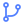 
<b>Geliştirme araçları &amp; iş akışı</b> 
Git, REST API'ler, teknik dokümantasyon ve yayına alma süreçleri; yapay zekâ destekli geliştirme, sürecin denetlenen bir parçası olarak.  
<code>git</code> <code>docs</code> <code>deploy</code>
</td>
</tr>
</table>

## 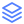 Teknoloji ekosistemi

<picture>
  <source media="(max-width: 600px)" srcset="./assets/ecosystem-tr-mobile.svg">
  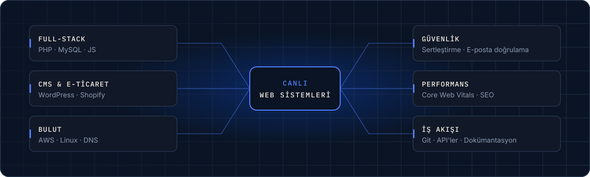
</picture>

<table>
<tr>
<td valign="top" width="30%">&nbsp; <b>Programlama &amp; backend</b></td>
<td valign="top">&nbsp;PHP &nbsp;·&nbsp; &nbsp;MySQL &nbsp;·&nbsp; 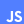&nbsp;JavaScript &nbsp;·&nbsp; &nbsp;REST APIs 
Özel web özellikleri için backend mantığı, veri işleme, formlar ve entegrasyonlar.</td>
</tr>
<tr>
<td valign="top" width="30%">&nbsp; <b>Front-end &amp; arayüz</b></td>
<td valign="top">&nbsp;HTML5 &nbsp;·&nbsp; &nbsp;CSS3 &nbsp;·&nbsp; &nbsp;jQuery &nbsp;·&nbsp; &nbsp;LESS &nbsp;·&nbsp; &nbsp;SCSS &nbsp;·&nbsp; 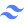&nbsp;Tailwind CSS &nbsp;·&nbsp; &nbsp;Bootstrap 
Figma tasarımlarından, yeniden kullanılabilir bileşenlerle responsive arayüzler.</td>
</tr>
<tr>
<td valign="top" width="30%">&nbsp; <b>CMS &amp; e-ticaret</b></td>
<td valign="top">&nbsp;WordPress &nbsp;·&nbsp; 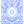&nbsp;Gutenberg &nbsp;·&nbsp; &nbsp;ACF &nbsp;·&nbsp; &nbsp;Codestar Framework &nbsp;·&nbsp; &nbsp;WPML &nbsp;·&nbsp; &nbsp;WooCommerce &nbsp;·&nbsp; 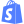&nbsp;Shopify Liquid 
Özel temalar, panelden düzenlenebilir içerik, çok dilli siteler ve mağazalar.</td>
</tr>
<tr>
<td valign="top" width="30%">&nbsp; <b>Bulut &amp; altyapı</b></td>
<td valign="top">&nbsp;AWS &nbsp;·&nbsp; &nbsp;Amazon SES &nbsp;·&nbsp; &nbsp;Linux &nbsp;·&nbsp; &nbsp;WHM/cPanel &nbsp;·&nbsp; 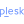&nbsp;Plesk &nbsp;·&nbsp; &nbsp;Apache &nbsp;·&nbsp; &nbsp;LiteSpeed 
Hosting kurulumu ve yönetimi, taşıma, yayına alma ve sorun giderme.</td>
</tr>
<tr>
<td valign="top" width="30%">&nbsp; <b>Güvenlik &amp; ağ</b></td>
<td valign="top">&nbsp;Cloudflare &nbsp;·&nbsp; &nbsp;DNS &nbsp;·&nbsp; &nbsp;SSL/TLS &nbsp;·&nbsp; &nbsp;SMTP &nbsp;·&nbsp; &nbsp;SPF &nbsp;·&nbsp; &nbsp;DKIM &nbsp;·&nbsp; &nbsp;DMARC 
Domain ve sertifika yönetimi, e-posta doğrulama ve edge koruması.</td>
</tr>
<tr>
<td valign="top" width="30%">&nbsp; <b>Performans &amp; SEO</b></td>
<td valign="top">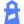&nbsp;Lighthouse &nbsp;·&nbsp; &nbsp;PageSpeed Insights &nbsp;·&nbsp; &nbsp;Core Web Vitals &nbsp;·&nbsp; &nbsp;Yapısal veri 
Gerçek darboğazları ölçüp kaynağında çözmek.</td>
</tr>
<tr>
<td valign="top" width="30%">&nbsp; <b>Geliştirme araçları</b></td>
<td valign="top">&nbsp;Git &nbsp;·&nbsp; &nbsp;GitHub &nbsp;·&nbsp; &nbsp;Figma 
Versiyon kontrolü, ekip çalışması ve tasarım teslimi.</td>
</tr>
</table>

##  Bulut altyapı &amp; güvenlik

Yalnızca kodla değil, sitenin altındaki katmanlarla da ilgileniyorum.

<table>
<tr>
<td width="50%" valign="top">
 
<b>Hosting</b> 
WHM/cPanel ve Plesk üzerinden, Apache ve LiteSpeed ile AWS ve Linux hosting kurulumu ve yönetimi.  
<code>aws</code> <code>linux</code> <code>cpanel</code> <code>plesk</code>
</td>
<td width="50%" valign="top">
 
<b>Domain &amp; yayın</b> 
Domain, DNS, SSL/TLS ve Cloudflare yönetimi; yayına alma ve sunucu taşıma.  
<code>dns</code> <code>ssl/tls</code> <code>cloudflare</code>
</td>
</tr>
<tr>
<td width="50%" valign="top">
 
<b>E-posta</b> 
SMTP, mail sistemleri ve Amazon SES yapılandırması; SPF, DKIM ve DMARC doğrulaması.  
<code>smtp</code> <code>ses</code> <code>spf</code> <code>dkim</code> <code>dmarc</code>
</td>
<td width="50%" valign="top">
 
<b>Sertleştirme</b> 
Sunucu sertleştirme, erişim kontrolleri ve güvenli yapılandırma.  
<code>hardening</code> <code>access</code>
</td>
</tr>
<tr>
<td width="50%" valign="top">
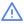 
<b>Olaylar</b> 
Şüpheli trafiğin incelenmesi, ele geçirilmiş siteler ve canlı ortam sorunlarının çözümü.  
<code>triage</code> <code>recovery</code>
</td>
<td width="50%" valign="top">
 
<b>Güvenilirlik</b> 
Yedekleme, kurtarma, izleme ve rutin canlı ortam bakımı.  
<code>backups</code> <code>monitoring</code>
</td>
</tr>
</table>

##  Performans &amp; teknik optimizasyon

Hız ve arama görünürlüğü sonradan yapılan bir düzeltme değil, işin baştan bir parçası.

<table>
<tr>
<td width="50%" valign="top">
 
<b>Core Web Vitals</b> 
LCP, CLS ve INP'nin Lighthouse ve PageSpeed Insights ile ölçülüp kaynağında düzeltilmesi.  
<code>lcp</code> <code>cls</code> <code>inp</code>
</td>
<td width="50%" valign="top">
 
<b>Teslim</b> 
Önbellekleme, varlık optimizasyonu ve görsel yönetimi.  
<code>caching</code> <code>assets</code>
</td>
</tr>
<tr>
<td width="50%" valign="top">
 
<b>Taranabilirlik</b> 
Arama motorlarının takip edebileceği site yapısı, indekslenebilirlik ve meta veriler.  
<code>indexing</code> <code>metadata</code>
</td>
<td width="50%" valign="top">
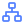 
<b>Yapısal veri &amp; analitik</b> 
Sayfayla uyumlu schema işaretlemesi, analitik entegrasyonları ve teknik teşhis.  
<code>schema</code> <code>analytics</code>
</td>
</tr>
</table>

##  Mühendislik iş akışı

<picture>
  <source media="(max-width: 600px)" srcset="./assets/lifecycle-tr-mobile.svg">
  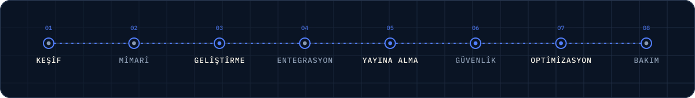
</picture>

Bir web sitesini tek seferlik bir teslimat değil, canlı bir sistem olarak ele alıyorum. Her proje gereksinimleri anlamak ve sürdürülebilir bir mimari seçmekle başlar; geliştirme ve entegrasyonun ardından yayına alınır, güvenli hale getirilir, optimize edilir ve canlıda sağlıklı tutulur.

<table>
<tr><td></td><td>Her projede okunabilir geçmişe sahip <b>Git</b></td></tr>
<tr><td></td><td>Bir sonraki değişikliği öngörülebilir kılan <b>dokümantasyon ve geliştirme standartları</b></td></tr>
<tr><td></td><td>Yayınları tekrarlanabilir tutan <b>yayına alma süreçleri</b></td></tr>
<tr><td>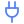</td><td>Hata durumunu düzgün yöneten <b>REST API entegrasyonları</b></td></tr>
<tr><td></td><td>Her değişikliği yayından önce gözden geçirerek <b>yapay zekâ destekli geliştirme</b></td></tr>
</table>

##  Profesyonel geçmiş

<table>
<tr><th></th><th align="left">Dönem</th><th align="left">Rol</th></tr>
<tr><td></td><td>2024 – günümüz <code>mevcut</code></td><td><b>Crabs Media</b> Web Developer · Full-Stack Development &amp; Systems Administration</td></tr>
<tr><td></td><td>2021 – günümüz <code>paralel</code></td><td><b>Freelance</b> Web geliştirme &amp; teknik danışmanlık, proje bazlı</td></tr>
<tr><td></td><td>2023 – 2024 <code>önceki</code></td><td><b>Current Works Media Teknoloji A.Ş.</b></td></tr>
<tr><td></td><td>2021 – 2023 <code>önceki</code></td><td><b>PenDigital</b></td></tr>
</table>

<table>
<tr>
<td width="50%" valign="top"> <b>Eğitim</b> Akdeniz Üniversitesi Bilgisayar Mühendisliği, lisans</td>
<td width="50%" valign="top">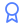 <b>Sertifika</b> IBM SkillsBuild + Kodluyoruz CyberStart Tamamlama Sertifikası (2024)</td>
</tr>
</table>

##  Teknik ilgi alanları

Yerleşik profesyonel işimden ayrı olarak aktif şekilde keşfettiğim alanlar:

&nbsp;Betik ve araç geliştirme için <b>Python</b> 
&nbsp;Rutin geliştirme ve operasyon işlerinin otomasyonu 
&nbsp;Yapay zekâ destekli geliştirme süreçleri 
&nbsp;Yazılım araçları ve teknik denemeler

##  İletişim

&nbsp;<a href="https://github.com/dkansener">github.com/dkansener</a> 
&nbsp; İzmir, Türkiye

